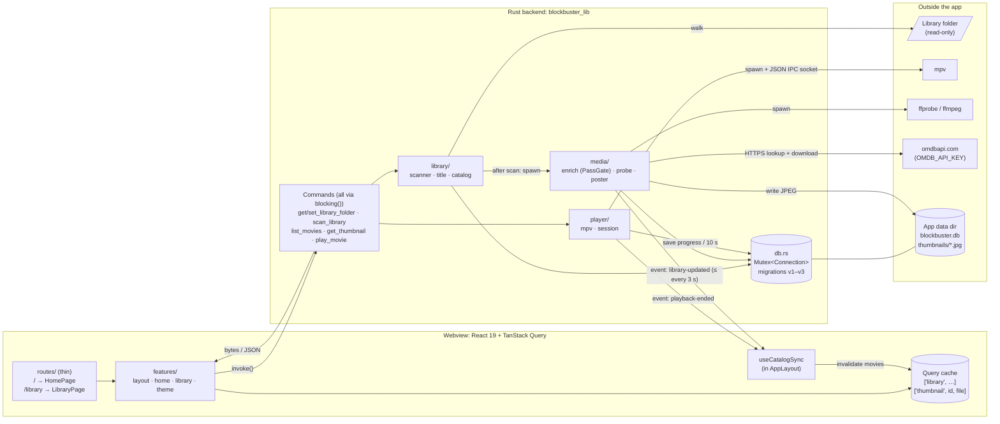
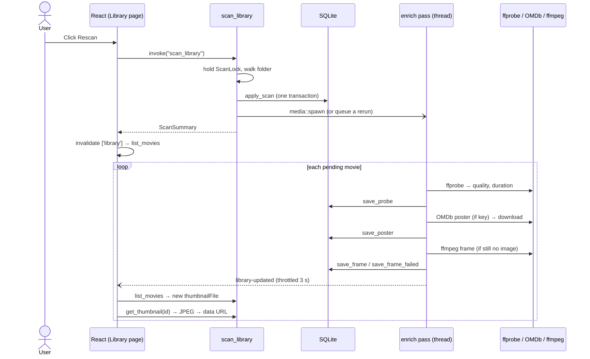
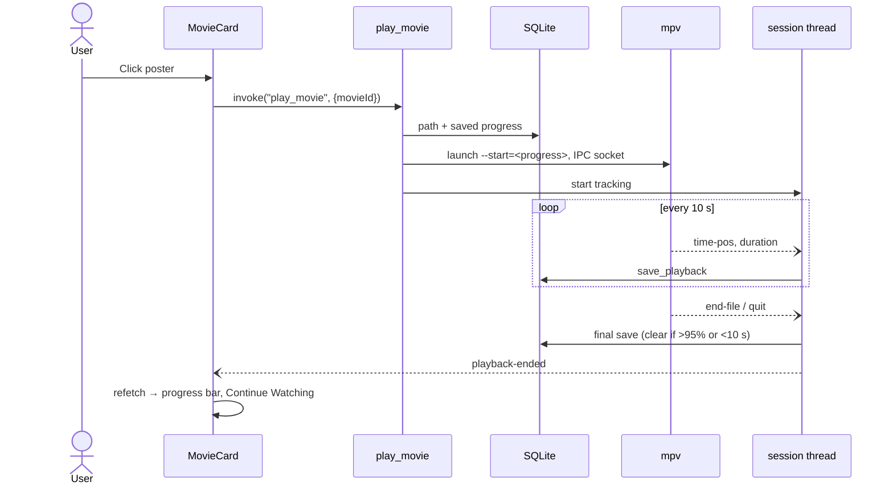

# Architecture

Blockbuster is a Tauri 2 desktop app. A React frontend in the webview calls a Rust backend over Tauri IPC. The backend owns all state in one SQLite file and drives three external tools: mpv for playback, ffprobe/ffmpeg for metadata and frames, and the OMDb web API for posters. Module-level detail lives in [CLAUDE.md](../CLAUDE.md).

## Components

The frontend only talks to the backend through `invoke()` commands, and the backend only pushes changes back through two events, which `useCatalogSync` turns into catalog refetches.

## Scan, then metadata fill-in

A scan only diffs the folder against the catalog, so it stays fast. Quality, duration and thumbnails are filled in afterwards by a background pass, and the UI updates as results arrive. Thumbnails reach the webview as bytes from `get_thumbnail`, not through `asset://`, which WebKitGTK blocks on the dev server origin.

## Playback and resume

One movie plays at a time. The session thread saves the position every 10 s and when mpv exits, then tells the UI to refresh progress bars and Continue Watching.

